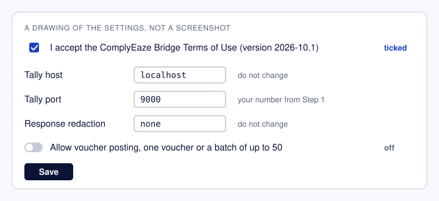
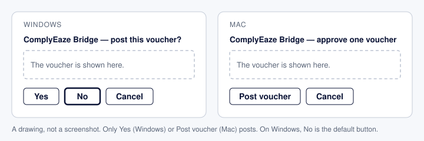

# Install ComplyEaze Bridge in Claude Desktop

ComplyEaze Bridge lets Claude, on your computer, read your TallyPrime books when you ask it a question.
These steps take you from nothing to your first answer. Do them in order. The steps themselves make no entry in your
books. The [Download page](https://bridge.complyeaze.com/download.html) chooses the current GitHub Release file for your
operating system and gives the same setup steps in short form; this guide is the fallback when that page is unavailable.

ComplyEaze Bridge is made by SPMS Comply Eaze Solutions LLP (ComplyEaze). Its source code is public.

What we checked ourselves, and what we did not. The Claude Desktop install screens and buttons in these steps are as
seen in our tests on 1 and 2 October 2026. The Mac had Claude Desktop version 2.19675.0 (read from the app's files),
and the maintainer reports that the Windows PC had the same version. The TallyPrime screens of Step 1 (F1, Settings,
Connectivity, the Client/Server configuration box and its list), the browser check, and the Alt+K and Alt+Y menus were
checked by looking, on TallyPrime 7.1 on Windows on 10 October 2026; saving with Ctrl+A, restarting TallyPrime and
the Backup & Restore submenu were not part of that check. The Mac keys are written from general knowledge of those programs; we did not walk them
ourselves. On a Mac, the question in Step 6 ("Which company is open in Tally?") has not been run by us. These are
other companies' programs and they change, so a screen of yours may differ a little.

## At a glance, release 0.7.0

- **You can ask for** outstanding receivables and payables with ageing, the trial balance, the vouchers in a date range (found by number, reference, narration or amount, and added up by ledger, month, voucher type, group or primary group; checked on one synthetic book, not a large one), Tally's own Cash Flow for whole months (shown only when its net total ties to the trial balance; not a cash flow statement under AS 3; tried on two synthetic books), one ledger's movement, Tally's own month-wise Sales or Purchase Register for whole months (not tied to the vouchers; read on one synthetic book), Tally's own Negative Stock and Negative Ledgers lists for a window (being listed is not a finding; synthetic books only), and the vouchers of one type that Tally marks Uncertain in its GSTR-1 (a Sales type, measured on one synthetic book).
- **Partly:** profit and loss and the balance sheet (a book with stock items is read only when Tally's own closing stock closes every gap, measured on one synthetic book; a book with several currencies is refused); closing stock value at a month's last day, and its closing quantity (compared with Tally's own Stock Summary for an item on a line of its own, the item list's own for an item inside a stock group), on small books, checked on two lab books; and a file of Payment, Receipt and Contra vouchers from a password-protected SBI, HDFC, Union Bank of India or Bank of Baroda PDF statement, which you check and import in Tally yourself. It creates no ledger, it cannot build onto a Cash-in-Hand ledger, and it has not yet been run on a real bank statement.
- **Not in this release:** GST returns or GSTR-2B matching, making sales or purchase invoices or GST entries, tax-audit flags (one test, the cash share of receipts and payments against the s.44AB(a) limit, is off by default and not yet run against a live TallyPrime), and Tally's Funds Flow and Ratio Analysis reports.

"You can ask" means it answered on the books and builds we ran it on; we have not yet run the published 0.7.0 file against TallyPrime (the program inside the published Windows x64 0.6.1 file (checked against its `.sha256` file) had one read-only run against a live TallyPrime 7.2 Silver, on one Windows computer on 27 October 2026, started directly by our test client rather than installed in Claude Desktop; it reported version 0.6.1, read Tally's status, the company list and the ledger masters of one synthetic company; nothing was posted); the macOS file has not been run against TallyPrime; our one recorded run of the published 0.6.0 file against a live TallyPrime posted one Contra to a synthetic company on one Windows computer on 16 October 2026 (#1780) and read it back; the other 0.6.0 posts ran on a release-candidate build and a rehearsal build. Very large books can fail or take longer than the assistant waits, and a book with several currencies is read only in part. Check any figure you rely on against Tally. The [Questions page](https://bridge.complyeaze.com/faq.html#what-can-i-ask) has the full table and its limits.

## Before you start

**You need three things on one computer:**

- **A Windows PC (x64), or a Mac with an Apple chip (M1 or newer).** Macs with an Intel chip are not supported.
- **TallyPrime, opening on that same computer.** A Tally that you can open only on another computer cannot be reached.
- **Claude Desktop.** This is the Claude program you install on your computer; Claude in a web browser will not work
  for this. Get it from <https://claude.com/download>, install it, and sign in to your Claude account. In one test on
  Windows, a Claude account with no paid plan worked; we make no claim about other plans.

**On Windows, ComplyEaze Bridge also needs Microsoft's Visual C++ Redistributable (x64).** Many programs install it,
so you may already have it. If you do not have it, or are not sure, download and run Microsoft's installer for the
latest supported x64 version, `vc_redist.x64.exe`, from <https://aka.ms/vc14/vc_redist.x64.exe>
([Microsoft's page](https://learn.microsoft.com/en-us/cpp/windows/latest-supported-vc-redist) lists it), before Step 3.
Installing the latest version updates an older one. We have not measured what Claude Desktop shows when it is missing.

**Three things to know:**

- **Use a test company first.** Make a new company in TallyPrime with a few made-up entries (press **Alt+K**, choose
  **Create**, give it any name). It does not touch your other companies. Keep only the test company open in Tally while you
  try this. ComplyEaze Bridge is still being developed, so a release may contain errors:
  try it on test data first and keep current backups. To take a backup in TallyPrime, press **Alt+Y**,
  choose **Backup & Restore**, and back up the company from there.
- **What Claude reads from Tally is sent to Anthropic**, the company that runs Claude. With real books, that includes
  party names and amounts. Decide about real books after it works on the test company; see
  [When you move to real books](#when-you-move-to-real-books).
- **Claude cannot make entries in Tally unless you switch that on.** It is off when you install, and these steps leave
  it off.

> **On a Mac?** Do [Step 0](#step-0-mac-only-let-the-mac-reach-tally) first. On Windows, skip to Step 1.

## Step 0 (Mac only). Let the Mac reach Tally

TallyPrime is a Windows program. On a Mac it runs inside a Windows window made by a program such as Parallels or
VMware. Claude Desktop and ComplyEaze Bridge run on the Mac itself. So Tally's answers must be passed from the Windows
window to the Mac.

Keys inside the Windows window on a Mac laptop: for **F1** hold **fn** and press **F1**; **Alt** is the **Option**
key; **Ctrl** is the **Control** key.

1. Do **Step 1 inside the Windows window**, including the check, using the browser inside Windows (Microsoft Edge, from
   the Windows Start menu).
2. Then open **Safari on the Mac itself** and type the same address: `http://localhost:9000/status`.
   - You see the same short line from Tally: the Mac can reach Tally. Go on to Step 2, and do Steps 2 to 6 on the Mac
     itself, not inside Windows.
   - Safari says it cannot open the page: Tally is fine, but the Mac cannot reach it yet. This needs one setting in
     Parallels or VMware called **port forwarding**. Do not guess at it. A forwarding rule can make Tally reachable
     from other computers on the network. It must be set up, and approved, by
     whoever looks after the Mac for your organization, and used only on a network you trust. Not every edition of
     Parallels offers it. We do not yet have click-by-click steps. Send that person this message, with your own
     port number:

     > Please add a port forwarding rule to the Windows virtual machine on this Mac: TCP, from port 9000 on the Mac
     > to port 9000 in Windows. The Mac side must listen on the Mac's own loopback address only (127.0.0.1), not on
     > all of the Mac's addresses. If the rule cannot be limited like that, the Mac's firewall must block the port
     > from outside. Two tests: (1) `http://localhost:9000/status` opens in Safari on the Mac; (2) from another
     > computer on the same network, first confirm it can reach this Mac at all (for example, it can open a page or
     > a shared folder the Mac offers); then `http://<this Mac's network address>:9000/status` must NOT open. If the
     > Windows virtual machine has its own address on the network (for example in bridged networking), then
     > `http://<the virtual machine's network address>:9000/status` must NOT open either. A computer that cannot
     > reach the Mac at all proves nothing.

In Claude Desktop on a Mac, a candidate build of 0.4.0 has been installed and its tools have loaded in a chat. The
package CI built for 0.4.1 was later installed over it, and two tools, `tally_status` and `list_companies`, answered
once from Tally in a chat on 2 October 2026. The question in Step 6 has not been run there. The
[README](../../README.md#what-has-been-run-against-a-real-tallyprime) lists what has been run and what has not.

## Step 1. Let Tally answer on your computer

Tally can answer other programs on the same computer, such as ComplyEaze Bridge. This is switched off until you turn
it on. It changes one setting in TallyPrime and no data.

**A caution before you turn it on.** With this setting on, Tally may answer other computers on the same network too,
without asking for a password: a browser on another computer that opens the Tally computer's network address and the
port can get Tally's "TallyPrime Server is Running" answer, and possibly more. ComplyEaze Bridge only ever calls Tally
from this same computer, but the setting is Tally's own. What keeps
other computers out is the firewall of the computer Tally runs on: on a Mac, that is the Windows firewall inside the
virtual machine. Check that the firewall does not allow incoming connections to the port, and that you are on a
network you trust.

1. Open TallyPrime and open your test company.
2. Press **F1**. A Help menu opens. Choose **Settings**, then **Connectivity**.
3. Move to the line **Client/Server configuration** and press **Enter**. On our check a box opened with three lines:
   **TallyPrime acts as**, **Enable ODBC** and **Port**. Leave **Enable ODBC** as it is: it is another way for programs
   to read Tally, and ComplyEaze Bridge does not use it.
4. Look at the line **TallyPrime acts as**. Write down what it says now, so that you can set it back one day.
5. On that line press **Enter**, choose **Both** from the list, and press **Enter**.
6. Look at the line **Port**. It shows a number, usually **9000**. Write the number down. You need it in Step 4.
7. Press **Ctrl+A** to save.
8. Close TallyPrime and open it again. Open the test company again.

**Check that it worked.** Open a web browser on the same computer. Click the long bar at the very top where web
addresses appear, delete what is there, type exactly this, and press **Enter**. Use your own number if it is not 9000.

    http://localhost:9000/status

| What you see | What it means |
| --- | --- |
| A short line of text that mentions Tally, such as "TallyPrime Server is Running" | It worked. Go to Step 2. Some browsers add a line of their own above it, saying the XML file has no style information. That line comes from the browser and is not an error. |
| A list of search results | You typed in a search box. Type it in the long bar at the very top instead. |
| "This site can't be reached", or similar | Tally is closed, or the setting is not on yet, or the number is different. Check that TallyPrime is open, do Step 1 again, and make sure you closed and reopened TallyPrime. |
| The page keeps loading and nothing appears | Tally is busy. Wait a minute and try again, two or three times. Do not change the setting. |

## Step 2. Download ComplyEaze Bridge

1. Open the [Download page](https://bridge.complyeaze.com/download.html).
2. Click **Download for Windows** or **Download for Mac**, to match your computer. (On a Mac choose **Download for
   Mac**, even though Tally is inside Windows.)
3. The file goes to your **Downloads** folder. Its name starts with `bridge-tally` and ends with `.mcpb`. You do not
   need to open it; Step 3 does that.

Your browser or your computer may warn you about the file. The package is not yet code-signed or notarized, so your
computer cannot confirm who made it. Keep the file only if you got it from the page above.

## Step 3. Add it to Claude Desktop

1. Open Claude Desktop.
2. Open **Settings**. If you cannot find it, click your name or initials at the bottom left of the Claude window;
   Settings is in the list that opens.
3. Click **Extensions**, then **Advanced settings**.
4. Click **Install Extension…**. A file window opens. Go to **Downloads** and choose the file from Step 2.
5. A page opens with the name **ComplyEaze Bridge** and a **notice from Claude Desktop, in red**. The notice is
   Claude Desktop's own. It tells you that an extension is a program that gets access to your computer, and that this
   one is **not verified by Anthropic**. Both are true. Read it.
   - What ComplyEaze Bridge does with that access: it talks to Tally on this computer; it keeps a receipt of each
     tool call on this computer; it saves there the voucher files it prepares and the voucher proposals it builds from bank statements; and
     it reads a file when a request names one.
   - If you do not want to go on, close the page and stop here.
6. To go on, click **Install**.
7. A small box asks **"Do you want to install ComplyEaze Bridge?"** Click **Install**.

## Step 4. Fill in the settings

A settings window opens with six lines. If none opens, open Settings, then Extensions, click ComplyEaze Bridge, then
**Configure**. Go from top to bottom.

| Line | What to do | What it is |
| --- | --- | --- |
| **I accept the ComplyEaze Bridge Terms of Use (version 2026-10.1)** | Read the [Terms of Use](https://bridge.complyeaze.com/terms.html). Then **tick** this box. If you do not own the practice, the owner should read and agree first. | Your agreement. Until you tick it, ComplyEaze Bridge does not read from Tally, and from release 0.5.1 every tool answers that the Terms of Use are not accepted and names this setting (the tools the assistant called gave that answer on one Mac with a test package and on one Windows computer with the build our checks made for this release). In 0.5.0, after an update from 0.4.2, Claude Desktop may not start ComplyEaze Bridge: on a Mac with an error that does not mention the Terms, on one Windows computer with no error (bridge#1413). |
| **Tally host** | Do not change it. It says `localhost`. | "This computer". Only this computer's own address is accepted. |
| **Tally port** | Type the number you wrote down in Step 1. | Where Tally answers. It is not a Tally licence port. Changing it here does not change Tally's own setting. |
| **Response redaction** | Do not change it. It says `none`. | A way to limit what ComplyEaze Bridge sends to the AI provider. Choose one value. The other two are `mask_parties` (shortens party and ledger names, and the bank account details read from a ledger, to their first two and last two characters; some names are not shortened, and narrations are not changed) and `drop_narration` (leaves out narration). Any other word stops ComplyEaze Bridge from starting. Neither hides, among other things: amounts, company names, PAN, GSTIN, IFSC, MSME or Udyam registration numbers, contact details and references, or the last four digits of a bank statement's account number. [Security and privacy](../security-and-privacy.md) lists the rest. |
| **Allow voucher posting, one voucher or a batch of up to 50** | Leave it **off**. | Lets Claude make entries in Tally: one voucher, or a saved batch of up to 50, each post only after you approve it in a separate window. |
| **Allow tax-audit test runs (audit_test_run)** | Leave it **off** unless you want to try a tax-audit test. | Lets Claude run one tax-audit test (today the cash share of receipts and payments against the s.44AB(a) limit) on a company's books for a period inside FY 2025-26. It reads every voucher of the period and writes nothing to Tally; its figures go to your AI provider like any read. It is refused while **Response redaction** is anything but `none`. |

Click **Save**.

## Step 5. Close Claude Desktop fully and open it again

Quit Claude Desktop completely and open it again. Closing the window is not enough; the program keeps running in the
background.

- **Windows:** look near the clock at the bottom right. If you do not see the Claude icon, click the small **^** arrow
  there. Right-click the Claude icon and choose **Quit**. Then open Claude Desktop again.
- **Mac:** click **Claude** in the menu bar at the top of the screen and choose **Quit Claude**. Then open Claude
  Desktop again.

Do this on both.

On the Mac in the 0.5.0 note under Step 4, Claude Desktop started ComplyEaze Bridge as soon as the settings were saved
and a new chat got an answer from it, but the assistant first called a leftover second entry for the same extension,
which failed with the same error; after Claude Desktop was quit and reopened there was one connector and no error.

## Step 6. Ask your first question

1. Make sure TallyPrime is open with your test company open.
2. In Claude Desktop, start a new chat and type: **Which company is open in Tally?**
3. Claude Desktop shows its own box asking whether Claude may use a tool from ComplyEaze Bridge. The buttons are
   **Deny**, **Always allow** and **Allow once**. Click **Allow once**. Claude will then ask you each time it wants to
   use a tool, which is the careful choice while you are trying it out. One question can need more than one tool.
4. Claude answers with the name of your test company. That is all. It is installed. (On a Mac this last result is
   the one we have not yet run ourselves; see the end of [Step 0](#step-0-mac-only-let-the-mac-reach-tally).)

**If something else happens:**

| What you see | What to do |
| --- | --- |
| Claude says the Terms of Use are not accepted | Go back to Step 4, tick the first line, click Save, then do Step 5. |
| Claude says it cannot reach Tally | Check that TallyPrime is open with a company open. Do the browser check in Step 1 again (on a Mac, in Safari on the Mac itself). Check that the Tally port in Step 4 is the same number. |
| Claude does not seem to know about Tally at all | Open Settings, then Extensions. Check that ComplyEaze Bridge is listed and switched on. Then do Step 5. In a new chat, **Connectors** also shows whether it is connected. On Windows, also check that Microsoft's Visual C++ Redistributable (x64) is installed (see "Before you start"). If you updated to 0.5.0 from 0.4.2, see "Remove or update it". |
| The settings window did not open in Step 4, or you want to change a setting | Open Settings, then Extensions. Click ComplyEaze Bridge, then **Configure**. |

Still stuck? See [Help](#help).

## When you move to real books

- **Decide who agrees.** What Claude reads, party names and amounts included, goes to Anthropic. How Anthropic keeps
  and uses it is set by your Claude account and Anthropic's own privacy policy. If the books belong to clients, the
  owner of the practice decides. How ComplyEaze Bridge itself handles information is in its
  [Privacy Policy](https://bridge.complyeaze.com/privacy.html).
- **Take a backup first** (Alt+Y, Backup & Restore, in TallyPrime).
- **Leave Tally's port alone.** Do not open it to the internet, and do not try to reach a Tally on another computer.
  ComplyEaze Bridge accepts only this computer's own address.
- **Reading and posting are separate.** Asking questions reads. Preparing a voucher file and reading a bank statement
  write nothing to Tally. Only posting writes, and it is off in a new install.

## If you turn posting on

Posting means Claude makes an entry (a voucher) in Tally. It stays off unless you switch on **Allow voucher posting, one voucher or a batch of up to 50**
in the settings. Read [The limits of posting](#the-limits-of-posting) before you do.

Even with posting on, **every post needs your approval** in a separate ComplyEaze Bridge window: for one voucher it shows
the voucher, for a saved batch a summary:

- **Windows:** the window asks "post this voucher?" with **Yes**, **No** and **Cancel**. Only **Yes** posts. **No**
  is the button already chosen, so pressing Enter does not post. **When you ask the assistant to post, stop typing in
  Tally until you have answered this window.** It also takes the keyboard: in our tests (Windows 10,
  TallyPrime 7.1 full screen, one screen, each tried once; #1780) a Down arrow moved its buttons on the 0.6.0 release
  candidate, and on the published 0.6.0 a typed **n** declined it and a typed **y** approved it. Answer it with the mouse. The Mac window has not been measured for this.
- **Mac:** the window says "approve one voucher" with **Post voucher** and **Cancel**. Only **Post voucher** posts; pressing Return may leave the window open.

There is no tool to undo or delete a posted voucher. A wrong entry must be corrected by hand in Tally.

## Remove or update it

- **Remove:** open Settings, then Extensions, click ComplyEaze Bridge and uninstall it there. This changes nothing in
  Tally. If you want Tally as it was, set **TallyPrime acts as** back to what you wrote down in Step 1. Removing it
  may leave ComplyEaze Bridge's data folder on the computer, unencrypted. Nothing in it is shortened or hidden. Among
  other files, it holds:
  - the import journal and saved batches: every voucher it prepared or posted, with dates, narrations, amounts and
    ledgers;
  - the bank-statement proposals: every row of a statement you asked it to read, with date, amount, bank reference
    and narration, the bank, suspense and other ledger names you chose, and the last four digits of the account number;
  - the receipt log: tool names, times and sizes, with no names or amounts;
  - a small record for each review of a posted voucher you record, which can include the name you sign in to the
    computer with.
  - a record of your acceptance of the Terms of Use.

  Section 7 of the
  [Privacy Policy](https://bridge.complyeaze.com/privacy.html) explains how to archive them: keep the import journal in an
  encrypted archive rather than deleting it. Section 4 of [Security and privacy](../security-and-privacy.md) lists
  every file.
- **Update:** it does not update by itself. Stop ComplyEaze Bridge, and every other program that uses it, before you
  update, as the paragraph on upgrading under "The limits of posting" says. Keep the data folder. Install the newer file
  as in Step 3, then look at the settings in Step 4. What we saw, release by release:
  - **0.4.0 to 0.4.1, early October 2026, one Mac.** Going from 0.4.0 to the package CI built for 0.4.1, Claude Desktop
    showed an **Update** button; the settings and the Terms setting carried over, ComplyEaze Bridge started again on its
    own, and no quit was needed. That test covered Claude Desktop only, and it is not what later releases did.
  - **0.4.2.** It installed as a second extension beside an older release instead of replacing it (its author line
    changed, and Claude Desktop includes the author in an extension's identity; seen on a Mac, not tried on Windows).
  - **0.5.0.** The package our checks built for 0.5.0, installed on one Mac over 0.4.2, replaced it as an update: one
    extension at version 0.5.0, the Tally port, Response redaction and the posting setting as they were (a posting
    setting that was on stayed on), the old Terms setting gone and no value for the new one (version 2026-10.1). With
    the published 0.5.0 file, on one Mac, the Tally port and Response redaction were kept and the Terms setting was
    dropped the same way (bridge#1413). On one Windows computer, the published 0.5.0 file over 0.4.2 was not started
    either: the chat showed no ComplyEaze Bridge tool and no error.
  - **Terms and 0.5.1.** Before the box is ticked, Claude Desktop may not start 0.5.0 at all; from 0.5.1 it starts
    ComplyEaze Bridge, and every tool answers that the Terms of Use are not accepted (the tools the assistant called
    gave that answer on one Mac with a test package and on one Windows computer with the build our checks made for this
    release; bridge#1413).
- **What to do after updating.** Tick the Terms setting, check **Allow voucher posting, one voucher or a batch of up to 50** (it is a new
  setting: if you turned posting on in an earlier version, turn it on again), then quit and reopen Claude Desktop.
- **A release older than 0.4.2.** Installing over one was not tried: remove such a release first.
- **Two ComplyEaze Bridge entries.** If Settings, then Extensions lists two entries (as happened when 0.4.2 was
  installed beside an older release), remove the older entry before you use either, and do not delete the data folder,
  which both versions use. Then enter your settings in the new one: the Tally port, the posting setting (posting starts
  off), the Terms setting and Response redaction (it starts at none; set it again if you had shortened or masked
  names), and quit and reopen Claude Desktop.

## Help

- Questions and problems: [open an issue on GitHub](https://github.com/ComplyEaze/bridge/issues), or write to
  contact@complyeaze.com. Say which step you were on and what the screen showed. Do not send client names or figures.
- Something that looks like a security problem: follow [SECURITY.md](../../SECURITY.md), not a public issue.

## For IT staff

- **Checking the download.** Releases are on [GitHub Releases](https://github.com/ComplyEaze/bridge/releases), the
  newest first. Each archive has a same-named `.sha256` file and a small provenance record on its release, so an
  organization can identify the downloaded bytes and the source commit. Run `certutil -hashfile "<file>" SHA256` on
  Windows or `shasum -a 256 "<file>"` on a Mac, in the folder that holds the file (a command window opens in your
  home folder, so `cd Downloads` first), with the file's name in place of `<file>`, brackets included, and keep the quotes (a file
  downloaded twice can get a name with "(1)" in it, which needs them). Compare the 64-character code it prints with the code
  at the start of the `.sha256` file (open that file in Notepad or TextEdit).
- **Build attestation.** From 0.4.0 each archive also has a build attestation, which `gh attestation verify` can
  check. It says which workflow run and commit produced those bytes. It is not a code signature, no client checks it
  yet, and it does not show that the code is safe.
- **Platforms.** The packages target Windows x64 and Apple Silicon Mac (ARM64); Intel Mac and other platforms are not
  qualified. Package availability is not a host-validation claim; read each release's notes for its current gaps.
- **Other ways in.** Opening the `.mcpb` file directly may also start the install. To run from source instead, use the
  [source MCP setup](./README.md).

## The limits of posting

Voucher file preparation and bank-statement parsing are available by default;
they write nothing to Tally. **Voucher posting is off by default** while four
known limits remain. Tally aims an import at a company by its name and cannot bind it to a company's GUID. ComplyEaze Bridge's last request before the post checks that exactly one loaded company has the target's GUID and name, and that no other loaded company has the same name ignoring case and spacing; otherwise it refuses the post (bridge#607). A company renamed to, or loaded under, the target's name (or one differing only in case or spacing) in the moment after that check could still receive the voucher, if it has the voucher's ledgers. ComplyEaze Bridge may flag afterwards that the loaded companies changed, but cannot always say where the voucher went, and cannot prevent it (accepted residual, bridge#574). A ledger renamed and replaced in that same moment means the post can land in the replacement ledger. ComplyEaze Bridge marks the result as needing reconciliation when it sees that the ledger now resolves to a different master; a change that leaves the company's master mark unmoved, or is reverted before that check, is not seen, and a regroup in that moment is not detected (bridge#623). And ComplyEaze Bridge has no tool to delete or undo a voucher it has posted, so a wrong post must be corrected by hand in Tally. It records the REMOTEID each post sends, but no delete tool exists yet (bridge#579, bridge#582). And the approval window covers only ComplyEaze Bridge: another Tally connector in the same Claude Desktop that can change entries can do so without it.
Turning on **Allow voucher posting, one voucher or a batch of up to 50** in the
extension settings adds posting; every new posting still requires your approval in a separate ComplyEaze Bridge
dialog. For a batch there are two more limits: if Tally creates only some vouchers of a batch, ComplyEaze Bridge
reports which ones it finds in the book and which it does not, and refuses to post the missing ones again, so check
each in Tally (a voucher it does not find may still be in Tally, edited: do not re-enter it before you check); and a batch of more than 50, or one whose summary does not fit the window, is refused. Leave it off
unless you accept those risks. This is a new setting: if you turned posting on in an earlier version, turn it on
again.

With posting on, native posting accepts one Journal, Payment, Receipt or
Contra per approval, or a saved batch of 2 to 50 Journals, or of 2 to 50
Payments, Receipts and Contras, after one approval of a summary (per-ledger
totals, and a line for each voucher when there are ten or fewer and those lines
fit), with existing ledgers and no supplied voucher number. One setting covers
both. `BRIDGE_AGENT_ENABLE_BATCH_POST` is retired: while posting is on and it is
still set, `post_import` refuses as `setting_retired`; remove it.
Batch posting through ComplyEaze Bridge has run live on a synthetic company on licensed
TallyPrime Silver, 200 Journals in one import with a test build whose cap was
raised, and verified; it is not proven on a multi-user book (bridge#725). A Payment, Receipt or Contra is
refused if any of its ledgers, or their groups, moved since the file was built
so that a bank or cash leg no longer classifies as it did. Tally assigns the number. ComplyEaze Bridge uses a private request identity
for the native attempt; the selected XML file stays unchanged. Do not manually
import a file and then post it through ComplyEaze Bridge: if the original Journal was edited,
ComplyEaze Bridge may be unable to recognize that earlier business event.

While posting, pause other imports and ledger changes in the selected company
and leave Tally's product/licence mode unchanged. ComplyEaze Bridge's checks do not lock
out changes made directly in Tally or by other software.

Stop ComplyEaze Bridge and every client running its connector before upgrading, then restart
them with the newer version (see "Remove or update it" for what we saw when upgrading). Dispatch coordination uses the operating system's
local app-data folder on Windows and account home on macOS, independently of
launcher environment variables. Older processes may use a different coordination path.
Keep the recovery data when upgrading. New posting attempts add a native request
commitment to the journal; older connector builds cannot read that new record.
Use this version or a newer compatible build to reconcile it rather than removing
the journal to downgrade. Older receipts may lack evidence that every result
counter was actually reported. After upgrading, ComplyEaze Bridge keeps those receipts but
cannot confirm a clean response from them, even when the Journal matches in
Tally. Preserve the original history for investigation; do not repost the Journal
to replace its receipt.

ComplyEaze Bridge only accepts loopback Tally endpoints. Do not open a port to the
internet or use a remote host to make this work.

## Data and updates

ComplyEaze Bridge runs locally. When Claude uses a ComplyEaze Bridge tool, the selected Tally result
is sent to the AI provider used for that conversation, so the conversation is
not wholly local. Choose the package's redaction setting when it suits the
workflow.

Private MCPB downloads do not update automatically. To upgrade, keep the data
folder, install the newer release from the Extensions screen in Claude Desktop's
settings, then confirm its version and settings; "Remove or update it" says what
we saw. Use the same screen to uninstall. Neither action changes Tally's
HTTP gateway configuration.
